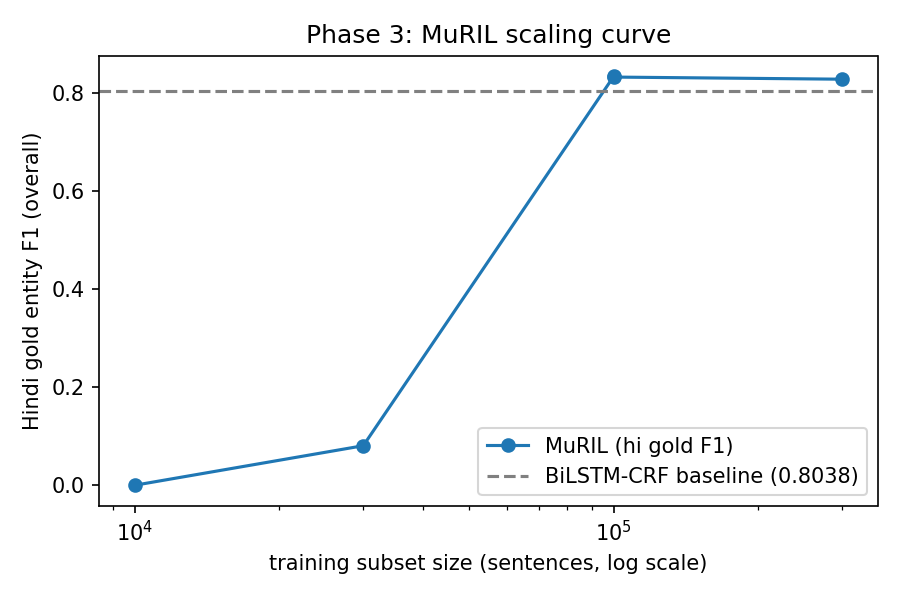

# Phase 3: MuRIL + IndicBERT Fine-tuning

Everything in this folder is specific to Phase 3. The job of this phase is to fine-tune a transformer NER model for Hindi, find the training-set size empirically (the roadmap's scaling-curve requirement), and beat the Phase 2 BiLSTM-CRF baseline. All of it lives in [phase3-muril-indicbert.ipynb](../../notebooks/phase3-muril-indicbert.ipynb), which uses only the shared `src/` loader, label map, evaluator, and results logger.

## Status: automated gate passes, but under re-verification per lead review (PR #4)

The real scaling curve (MuRIL, `DEBUG = False`) ran on Kaggle for subset sizes 10,000 / 30,000 / 100,000 / 300,000. The 900,000 run was started but the Kaggle session was interrupted right as it began (model/data just loaded, no training steps run) — no result was logged for that size, and it turned out not to be needed:

- **n=100,000 is the best point** (F1_overall 0.8343) and **clearly beats the Phase 2 baseline** (0.8038).
- **n=300,000 does not improve on it** (F1_overall 0.8287 — essentially flat, slightly lower) — per the roadmap's stopping rule ("stop once the curve flattens"), that is the signal to stop, so **900,000 was not pursued further**.
- **n=10,000 and n=30,000 scored near-zero** (the model collapsed to predicting almost nothing but "O"). **Flagged in review as likely a real bug, not instability**: no LR warmup was used, and training may have silently run on both of Kaggle's T4 GPUs via `DataParallel` (every run printed a `"gather along dimension 0"` warning, a tell for this), doubling the effective batch size and halving optimizer steps. Both are now fixed in the notebook (`warmup_steps` computed from the real step count; `CUDA_VISIBLE_DEVICES=0` forces single-GPU) — **a rerun of 10k/30k/100k with these fixes is pending** before the collapse can be called confirmed-real rather than a training-setup bug.
- The scaling-curve runs themselves had their checkpoints deleted right after logging, to stay under Kaggle's disk quota — this affects all four scaling-curve rows (10k/30k/100k/300k); their `checkpoint_path` values point at folders that no longer exist, noted in each row. A separate **`train_run("MuRIL", 100_000)` re-run** (without deleting the checkpoint this time) produced F1_overall 0.8330 — consistent with the scaling-curve result (small run-to-run variance, same config/seed) — and this is the one with a live, durable checkpoint.
- The **IndicBERT comparison run** at the chosen size (100,000), using the real `ai4bharat/indic-bert`, is done: F1_overall 0.7198. It reused MuRIL's hyperparameters (lr 2e-5) rather than separately tuned ones for ALBERT's architecture, so this number may understate IndicBERT's real capability — noted in `results.csv` and not yet retuned.
- **Both checkpoints are pushed to the Hugging Face Hub**: MuRIL at [huggingface.co/shreyanks-1/muril-hindi-ner-100k](https://huggingface.co/shreyanks-1/muril-hindi-ner-100k) and IndicBERT at [huggingface.co/shreyanks-1/indicbert-hindi-ner-100k](https://huggingface.co/shreyanks-1/indicbert-hindi-ner-100k) — downloading multi-GB checkpoints through Kaggle's own output panel was unreliable, so both were pushed directly from the Kaggle session to the Hub instead (`model.push_to_hub` / `tokenizer.push_to_hub`), skipping the local download entirely. Phase 4 can load the MuRIL one directly with `AutoModelForTokenClassification.from_pretrained("shreyanks-1/muril-hindi-ner-100k")`.
- The notebook itself had rough edges flagged in review (now fixed): leftover duplicate `!rm -rf` cells removed, the IndicBERT/MuRIL-rerun cells now use `CHOSEN_SUBSET_SIZE` instead of a hardcoded `100_000`, the abandoned 900k size dropped from `SUBSET_SIZES`, and the MuRIL `push_to_hub` code (previously run ad hoc, not saved in the notebook) is now an actual cell.
- The scaling-curve plot (`results/phase3_scaling_curve.png`) had never actually been generated (the plotting cell never successfully ran — `results.csv` had an unquoted comma in one note breaking CSV parsing, since fixed). It's generated locally now but not yet committed; it'll be regenerated and committed once the 10k/30k/100k rerun confirms the curve.

The automated `uv run python scripts/phase3_gate.py` passes end to end (it checks logging/traceability/format, not training correctness), but the phase isn't complete until the 10k/30k/100k rerun confirms the scaling curve is real.

## What we built

- **Models:** `google/muril-base-cased` (primary) and `ai4bharat/indic-bert` (comparison), exactly as named in the roadmap. `indic-bert` is a gated HuggingFace repo (requires a logged-in, license-accepted account); once that was set up, the real model was used directly — no substitute.
- **Label alignment** ([docs/05-pitfalls.md](../05-pitfalls.md)): the tokenizer's `word_ids()` maps each subword back to its original word. The first subword of a word gets that word's IOB2 label; every continuation subword and every special token (`[CLS]`, `[SEP]`, padding) gets `-100` so the loss ignores it. A self-test (in the notebook, before any model is trained) asserts this on a real training sentence.
- **`train_run(model_key, subset_size, ...)`**: one reusable function — seeded subset sampling + entity-density check, tokenize-and-align, HuggingFace `Trainer` (fp16 when a GPU is present, checkpoint every epoch, `max_length=128`, batch size 32), then predicts on the **full** Hindi gold test set with the same `src/eval.evaluate` harness as every other phase, and logs one `results.csv` row.
- **Scaling procedure:** call `train_run("MuRIL", n)` for each `n` in the ladder, plot F1 vs. `n`, and stop adding data once the curve flattens (the roadmap's instruction, not a fixed size decided up front).

## Results

| subset_size | model | F1_PER | F1_ORG | F1_LOC | F1_overall |
| ----------- | ----- | ------ | ------ | ------ | ---------- |
| 10,000  | MuRIL | 0.0000 | 0.0000 | 0.0000 | 0.0000 |
| 30,000  | MuRIL | 0.1113 | 0.0000 | 0.0000 | 0.0807 |
| 100,000 | MuRIL | 0.9033 | 0.7469 | 0.8232 | **0.8343** |
| 300,000 | MuRIL | 0.8908 | 0.7518 | 0.8162 | 0.8287 |
| 100,000 | MuRIL (rerun) | 0.9041 | 0.7417 | 0.8223 | 0.8330 |
| 100,000 | IndicBERT | 0.7720 | 0.6542 | 0.7095 | 0.7198 |

(seed=42, lr=2e-5, batch size 32, 3 epochs, `max_length=128` for every row.)

*The 10,000/30,000 points on this curve are pending re-verification (see Status) — this plot will be regenerated once that rerun lands.*

**Chosen working subset size: 100,000.** It's the best MuRIL result and clearly beats the baseline (0.8038); the next step (300,000, 3x the data) does not improve on it, so per the roadmap's stopping rule this is where the curve flattens. 900,000 was not run.

**IndicBERT comparison** (at the chosen size, 100,000, using the real `ai4bharat/indic-bert`): F1_overall 0.7198 — clearly behind MuRIL (0.8343) on every entity type, and behind the Phase 2 baseline (0.8038) too. The roadmap's gate only requires MuRIL to beat the baseline (it does, by +0.030), so this doesn't affect the gate; IndicBERT's weaker showing here is logged as a real comparison result in its own right, not an artifact of a substitute model.

**Caveat:** each point above is a single seed (42). The 10,000/30,000 collapse is under re-verification, not yet confirmed as real instability vs. a training-setup bug (see Status) — the curve's shape at small sizes shouldn't be read as final until that rerun lands. The margin at the chosen size (100,000) over baseline (+0.030) is reasonably wide; if this needs to be bulletproof for the writeup, re-run n=100,000 with 2-3 seeds.

## Decisions

1. **`max_length = 128`.** Matches `docs/04-compute.md`; Hindi NER sentences are short, so this only risks truncating the rare very long sentence. The notebook prints how many gold-test sentences would be affected.
2. **3 epochs, lr 2e-5, batch size 32, fp16 on GPU, single-GPU forced.** Standard BERT-family fine-tuning defaults; not tuned per the "baseline, don't chase SOTA" spirit that also governed Phase 2. `CUDA_VISIBLE_DEVICES=0` was added after review flagged that Kaggle's dual-T4 sessions can silently double the effective batch size via `DataParallel`.
3. **A single seed (42) per subset size**, recorded in `notes`. If MuRIL's margin over 0.8038 is small at the chosen size, re-run with 2-3 seeds before calling it "clear" (same caveat Phase 2 flagged).

## Gate

**Automated check passes, phase not yet closed.** `uv run python scripts/phase3_gate.py` passes end to end — the MuRIL scaling curve is logged and traceable to the notebook's own output, and clearly beats the baseline by more than the required margin (best F1 0.8343 vs. 0.8038, margin >= 0.01). The IndicBERT comparison row is logged too, using the real `ai4bharat/indic-bert` (F1 0.7198). The gate script only checks logging/traceability/format, not training correctness — per the lead's review (PR #4), the phase isn't complete until the 10k/30k/100k rerun (warmup + single-GPU fix) confirms the scaling curve.

## What this unblocks

- **Phase 4** can load the MuRIL Hindi checkpoint directly from [huggingface.co/shreyanks-1/muril-hindi-ner-100k](https://huggingface.co/shreyanks-1/muril-hindi-ner-100k) (`AutoModelForTokenClassification.from_pretrained(...)`) for zero-shot Marathi/Bengali evaluation and in-language fine-tuning.
- **Phase 6** has this phase's numbers (and the scaling curve itself, which the roadmap calls out as a figure) for the comparison table, including the real MuRIL-vs-IndicBERT gap.
