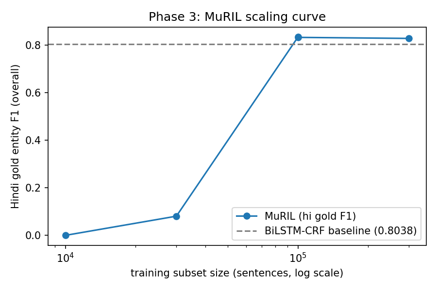
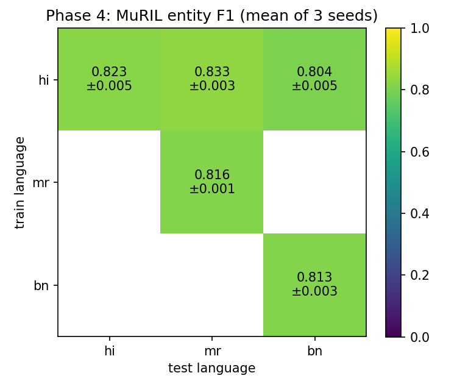
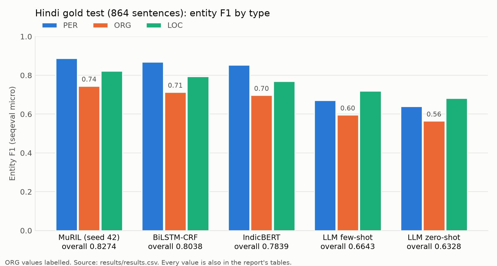
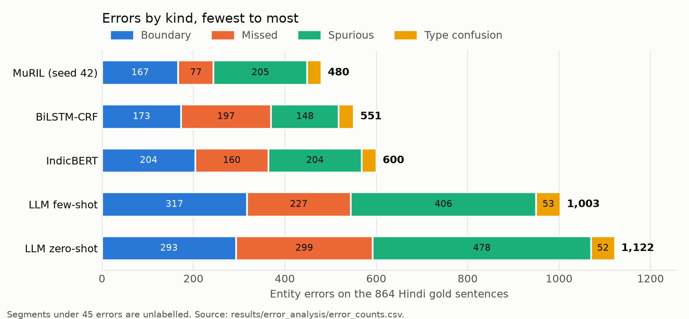

# NaamRekha: Named Entity Recognition for Hindi and Cross-Lingual Transfer to Marathi and Bengali

> **Phase 6 report.** Every reported number comes from a row in [results.csv](../../results/results.csv) or a saved, reproducible output. Appendix A maps each number to its source, and `uv run python scripts/phase6_gate.py` recomputes the reported numbers and checks that the report states them.

## Abstract

We build and compare four approaches to named entity recognition for Hindi on the Naamapadam dataset, training on silver labels and evaluating on human-annotated gold test sets. Fine-tuned MuRIL is the strongest Hindi model, with gold entity F1 **0.8274**, ahead of a BiLSTM-CRF baseline (**0.8038**), untuned IndicBERT (**0.7839**), and prompting Qwen2.5-7B (**0.6643** few-shot, **0.6328** zero-shot). Hindi-trained MuRIL also transfers without target-language training, with mean F1 **0.8332** on Marathi and **0.8037** on Bengali across three seeds. It beats the Marathi in-language baseline (**0.8163**) on all three seeds and trails the Bengali baseline (**0.8132**) on all three. Error analysis shows that the Marathi baseline falls behind mainly through lower recall, and that tokenizer coverage does not appear to explain the Bengali errors. The pattern is consistent with a benefit from shared script, but this two-target design cannot show that script matters more than language family.

## Outline

1. Introduction, research question, and related work
2. Data and evaluation method
3. Stage 1: BiLSTM-CRF baseline
4. Stage 2: MuRIL and IndicBERT fine-tuning
5. Stage 3: Cross-lingual zero-shot transfer
6. Stage 4: LLM prompting
7. Comparison across stages and error analysis
8. Script versus language family: discussion
9. Conclusion
10. Limitations, reproducibility, references
- Appendix A: where each number comes from

## 1. Introduction

We build a Named Entity Recognition system that tags person (PER), organisation (ORG) and location (LOC) spans in Hindi, then ask how far a Hindi-trained model transfers to Marathi and Bengali without further training. The four stages form a difficulty ramp: a from-scratch BiLSTM-CRF, fine-tuned multilingual transformers, zero-shot cross-lingual transfer, and prompting an open LLM. The sharpened hypothesis ([00-overview.md](../00-overview.md)): zero-shot transfer quality is gated more by **shared script** than by **language-family closeness**. Hindi to Marathi shares Devanagari and a family; Hindi to Bengali shares the family but not the script. Both targets are Indo-Aryan, so this design can test whether transfer differs across a script boundary. It cannot separate script from family, because no target has a shared script and a different family. In-language baselines give each target its own reference point.

### Related work

**Neural sequence labeling.** Conditional random fields model dependencies between neighboring labels (Lafferty et al., 2001). Lample et al. (2016) combined word embeddings, character representations, a BiLSTM, and a CRF for NER, which is the architecture of our first stage. Our word vectors come from fastText, which represents words through subword information (Bojanowski et al., 2017) and provides pretrained vectors for 157 languages (Grave et al., 2018).

**Transformers for Indian languages.** BERT introduced deep bidirectional transformer pretraining (Devlin et al., 2019). MuRIL is a BERT-based model built for Indian languages (Khanuja et al., 2021). IndicBERT comes from the IndicNLPSuite resources for Indian languages (Kakwani et al., 2020) and uses the ALBERT architecture (Lan et al., 2019).

**NER from projected labels.** Annotation projection creates labels for a target language from another language's annotations (Ni et al., 2017). Naamapadam applies this idea at scale to Indic languages and provides human-annotated test sets (Mhaske et al., 2023), so we train on its silver labels and evaluate on gold.

**Cross-lingual transfer.** Pires et al. (2019) showed that Multilingual BERT can transfer zero-shot, including to languages in different scripts, and that transfer works best between typologically similar languages. Their result motivates separating script from language similarity, which our two-target design can only partly address.

**LLMs for NER.** Wang et al. (2023) report that LLM performance on NER remains below supervised baselines because NER is sequence labeling while LLMs generate text. Our fourth stage measures this gap for Hindi with Qwen2.5 (Qwen Team, 2024), using a structured output format and a parser that counts malformed answers as errors.

## 2. Data and evaluation method

- **Dataset:** [Naamapadam](https://huggingface.co/datasets/ai4bharat/naamapadam) (`ai4bharat/naamapadam`), 11 Indic languages; we use `hi`, `mr`, `bn`. Training labels are **silver** (projected from English NER over parallel text, so large but noisy); test labels are **gold** (human annotated). We train on silver and evaluate on gold.
- **Tags:** IOB2 over PER/ORG/LOC; fixed order `O, B-PER, I-PER, B-ORG, I-ORG, B-LOC, I-LOC` defined once in `src/data.py` and imported everywhere.
- **Hindi sizes** ([phase1/README.md](../phase1/README.md)): train 985,787, val 13,460, test 867 raw; the loader drops 3 empty test rows, leaving **864 gold test sentences** (seqeval support: PER 790, ORG 525, LOC 614 entities). Marathi and Bengali gold test sets have 1,060 and 607 sentences ([phase4/README.md](../phase4/README.md)). About 0.5% of tokens carry orphan `I-` tags from label projection; we leave them as-is for parity with the published benchmark.
- **Metric:** entity-level micro-F1 with `seqeval` (Nakayama, 2018), overall and per type, from the one shared `src.evaluate`. Token accuracy is never reported (it is ~95%+ because `O` dominates). The LLM's text output is parsed back into IOB2 spans first, so all four stages are scored identically.
- **Splits:** train on a seeded silver subset, make size, model, and prompt choices on silver validation, and report on the **entire** gold test set of the target language. Section 10 discloses one earlier LLM draft that used gold test sentences.
- **Logging:** every run is one row in `results/results.csv` with model, languages, subset size, epochs, per-type and overall F1, checkpoint link and notes. Each phase has a gate script that checks its rows.

## 3. Stage 1: BiLSTM-CRF

The model follows Lample et al. (2016): fastText `cc.hi.300` word vectors (Grave et al., 2018) plus a character BiLSTM, a word-level BiLSTM (128 hidden per direction), and a CRF decoder (about 30.2M parameters). Trained on a seeded 100,000-sentence silver subset (seed 42), best epoch by silver validation F1 (epoch 4 of 7). The vocabulary contains the training-subset words plus val and test words that have a fastText vector. Pretrained vectors carry no labels, so this leaks no annotations, but the 0.8038 score should be read with this setup in mind. Details are in [phase2/README.md](../phase2/README.md).

| Model | Train size | PER | ORG | LOC | Overall | Source |
| ----- | ---------- | --- | --- | --- | ------- | ------ |
| BiLSTM-CRF | 100,000 | 0.8692 | 0.7130 | 0.7933 | **0.8038** | `results.csv`, seed 42 |

The roadmap expected the mid-to-high 60s; 0.8038 is well above that. Likely reasons given in Phase 2: noisy silver training but cleaner gold scoring, and fastText coverage of test words (test-token OOV 0.73%). Single seed.

## 4. Stage 2: MuRIL and IndicBERT

`google/muril-base-cased` (primary; Khanuja et al., 2021) and `ai4bharat/indic-bert` (comparison; Kakwani et al., 2020) with `AutoModelForTokenClassification`. Each word's label sits on its first real subword, skipping a standalone SentencePiece `▁` when IndicBERT produces one; other subwords and special tokens get `-100`. The training size was found from the data: a scaling ladder at 10k, 30k, 100k and 300k sentences, with a pre-set rule on **validation** F1 (not gold) selecting **300,000**. All numbers are in [phase3/README.md](../phase3/README.md).

| Model | Train size | Seeds | PER | ORG | LOC | Overall | Source |
| ----- | ---------- | ----- | --- | --- | --- | ------- | ------ |
| MuRIL (handoff, seed 42) | 300,000 | 1 | 0.8879 | 0.7444 | 0.8224 | **0.8274** | `results.csv` |
| MuRIL (mean of seeds 42, 43, 44) | 300,000 | 3 | | | | 0.8230 | Phase 3 rows for seeds 42 to 44 (0.8274, 0.8242, 0.8174) |
| IndicBERT (untuned, seed 42) | 300,000 | 1 | 0.8538 | 0.6968 | 0.7692 | 0.7839 | `results.csv` |

Findings: MuRIL beats the baseline on every seed (lowest 0.8174 vs 0.8038); the 10k, 3-epoch run collapsed to predicting no entities and recovered with 9 epochs (an under-training effect, not a data limit); gold F1 is flat from 30k upward (0.8230 to 0.8296 across size means), so the choice of 300k rests on validation, not on a clear gold gain; IndicBERT reuses MuRIL's hyperparameters on one seed, so 0.7839 is not its best possible score. 

*Figure 1: MuRIL scaling curve. Points show the mean across seeds, and bars show the range where several seeds were run.*

## 5. Stage 3: Cross-lingual zero-shot transfer

The three Phase 3 Hindi MuRIL models (seeds 42, 43, 44) are scored, with no further training, on Marathi and Bengali gold. Each target language also gets an **in-language baseline**: MuRIL fine-tuned on 300,000 sentences of that language with the Phase 3 recipe, once per seed. Every Phase 4 score is a freshly loaded model in 32-bit ([phase4/README.md](../phase4/README.md)). Mean gold F1 over three seeds (± standard deviation):

| Train \ Test | `hi` | `mr` | `bn` |
| ------------ | ---- | ---- | ---- |
| `hi` (zero-shot for `mr`, `bn`) | 0.8228 ± 0.0050 | **0.8332** ± 0.0030 | **0.8037** ± 0.0055 |
| `mr` (in-language) | | **0.8163** ± 0.0007 | |
| `bn` (in-language) | | | **0.8132** ± 0.0030 |

The `hi → hi` mean uses Phase 4's 32-bit re-score (0.8274, 0.8237, 0.8174); Phase 3 logged 0.8242 for seed 43 under fp16, hence its 0.8230 mean in Section 4. Transfer gap, paired by seed (in-language minus zero-shot):

| Target | Mean gap | Seeds 42 / 43 / 44 | Reading |
| ------ | -------- | ------------------ | ------- |
| Marathi | **−0.0169** (SD 0.0023) | −0.0142 / −0.0186 / −0.0178 | The Hindi model beats the Marathi-trained one, on all three seeds. |
| Bengali | **+0.0095** (SD 0.0051) | +0.0154 / +0.0063 / +0.0068 | In-language training helps slightly, on all three seeds. |

By type, the largest gaps are on ORG (Marathi −0.0364, Bengali +0.0165); Bengali LOC changes sign across seeds, so it is not established. Because the Hindi model beats the Marathi in-language run, that run is a baseline, not a true upper bound.

*Figure 2: Transfer matrix. Cells show mean gold entity F1 and standard deviation across three seeds.*

## 6. Stage 4: LLM prompting

A self-hosted open LLM (no external API) is prompted for PER/ORG/LOC spans as a JSON array, zero-shot and with 8 fixed few-shot examples, and its text output is parsed back into IOB2 by a documented, tested parser. Malformed output is counted as an error (all `O`), never dropped. The model was chosen on a 150-sentence validation sample, not on gold: `Qwen/Qwen2.5-7B-Instruct` (Qwen Team, 2024) in 4-bit (Apache-2.0, revision `a09a354...`) beat the 3B candidate by 0.11 F1, and the prompt (`v2`) was frozen before the final gold run. Setup, parser rules and validation rounds are in [phase5/README.md](../phase5/README.md). Scored on all 864 Hindi gold sentences in one clean Kaggle run:

| Setup | PER | ORG | LOC | Overall | Malformed / 864 | Source |
| ----- | --- | --- | --- | ------- | --------------- | ------ |
| LLM zero-shot | 0.6397 | 0.5644 | 0.6812 | **0.6328** | 11 | `results.csv` |
| LLM few-shot (k=8) | 0.6714 | 0.5956 | 0.7190 | **0.6643** | 5 | `results.csv` |

Examples help by 0.0315 F1 (indicative: one greedy run). Malformed outputs were 11 of 864 for zero-shot and 5 of 864 for few-shot. Six zero-shot and all five few-shot failures were answers cut off at the 320-token limit. The other five zero-shot failures were short answers with broken JSON, so a larger token limit would not fix them. The parser itself costs under 0.2 F1 points (feeding gold answers through it scores 0.9984).

## 7. Comparison across stages and error analysis

Hindi gold test, 864 sentences, entity-level micro-F1. The Stage 3 row is the Hindi control for the transfer experiment, so its target-language results are in Section 5.

| Stage | Model | Train size | PER | ORG | LOC | Overall |
| ----- | ----- | ---------- | --- | --- | --- | ------- |
| 1 | BiLSTM-CRF | 100,000 | 0.8692 | 0.7130 | 0.7933 | 0.8038 |
| 2 | MuRIL (handoff) | 300,000 | 0.8879 | 0.7444 | 0.8224 | **0.8274** |
| 2 | IndicBERT | 300,000 | 0.8538 | 0.6968 | 0.7692 | 0.7839 |
| 3 | MuRIL, Hindi-trained, tested on `hi` (3-seed mean) | 300,000 | 0.8867 | 0.7323 | 0.8210 | 0.8228 |
| 4 | LLM zero-shot (Qwen2.5-7B, 4-bit) | none | 0.6397 | 0.5644 | 0.6812 | 0.6328 |
| 4 | LLM few-shot (Qwen2.5-7B, 4-bit) | none | 0.6714 | 0.5956 | 0.7190 | 0.6643 |

The ranking is MuRIL > BiLSTM-CRF > IndicBERT (untuned) > LLM few-shot > LLM zero-shot. Prompting an open 7B model is about 0.16 F1 behind the fine-tuned MuRIL, which is itself a finding: in this setup, with silver training data available, a fine-tuned encoder clearly outperforms prompting one open general-purpose model. This does not rank all LLMs or all prompts.

*Figure 3: Entity F1 by type for the five Hindi systems. ORG is the lowest bar in every group.*

*Figure 4: Error kinds per Hindi system. The counts are in `results/error_analysis/error_counts.csv`.*

**Error analysis** ([phase5/error_analysis.md](../phase5/error_analysis.md), 864 gold sentences, same sentences for all systems):

- **ORG is the weakest type for every model** (0.7444 MuRIL, 0.5956 LLM few-shot). Per-type, the LLM is furthest from MuRIL on PER (−0.217), because of boundaries; ORG −0.149; LOC −0.103.
- **MuRIL:** most errors are spurious spans (205 of 480) and boundaries (167); ORG alone has 94 spurious spans and 64 boundary errors.
- **LLM few-shot:** about twice MuRIL's errors (1,003). Boundary errors are over-long spans (276 of 317 longer than gold: a role or title attached to a name). False alarms are generic words (`देश`, `प्रदेश`, `राष्ट्रपति`, `पुलिस`). Misses include plain place names. Examples cut spurious spans and misses by 72 each and add 24 boundary errors.
- **Shared with MuRIL:** gold LOC predicted as ORG is the largest type confusion for both (LOC as ORG: 21 LLM, 15 MuRIL), which points to gold conventions as part of the ceiling.
- **Format drift** is small: 11 and 5 malformed outputs, plus about 30 spans per mode that do not match the sentence (altered spelling, an added word, stray characters).
- **Across all Hindi stages:** MuRIL makes the fewest errors (480), then BiLSTM-CRF (551), IndicBERT (600), LLM few-shot (1,003), and LLM zero-shot (1,122). MuRIL's gain over BiLSTM-CRF is recall (77 vs 197 missed), although it makes more spurious predictions (205 vs 148). Of 1,929 gold entities, 1,023 are right in all four compared systems and 121 are wrong in all four, including 54 ORG entities.
- **Marathi and Bengali:** across three seeds, Marathi in-language models miss about 46 more entities than Hindi models and make about 12 fewer spurious predictions. Bengali in-language models miss about 12 fewer entities than Hindi models. Both patterns have the same sign on all three seeds.

### Concrete error examples

These examples were selected to illustrate error patterns, so they are not a random sample. Each comes from the saved gold-test predictions. In the Marathi and Bengali rows, the right and wrong outcomes hold on all three seeds.

| Language | Gold entity | Right | Wrong prediction | What it shows |
| -------- | ----------- | ----- | ---------------- | ------------- |
| Hindi | `सिबिल` (ORG) | MuRIL | BiLSTM-CRF, IndicBERT, and LLM predict nothing | A rare organization name is missed |
| Hindi | `नेस्डैक` (ORG) | MuRIL | IndicBERT and LLM: `नेस्डैक` (LOC); BiLSTM-CRF predicts nothing | ORG and LOC confusion |
| Hindi | `मोहम्मदVI` (PER) | MuRIL | LLM: `महामहिम किंग मोहम्मदVI` (PER); BiLSTM-CRF and IndicBERT predict nothing | The LLM includes a title in the name |
| Hindi | `एसएसएस स्प्रिंग्स` (ORG) | MuRIL, IndicBERT | BiLSTM-CRF: `एसएसएस स्प्रिंग्स , टॉक प्रो रेडियोज़` (ORG); LLM predicts nothing | Two neighboring organizations are merged |
| Hindi | `वन मंत्रालय` (ORG) | None | MuRIL: `मंत्रालय`; the other three: `केंद्रीय पर्यावरण मंत्री एवं वन मंत्रालय` | ORG boundaries are hard for every stage |
| Hindi | `सिंदरी` (ORG) | None | MuRIL and LLM: `सिंदरी` (LOC); BiLSTM-CRF and IndicBERT predict nothing | A place-like name labeled ORG in gold |
| Marathi | `सेव्हिल्ला` (LOC) | Hindi models | Marathi models predict nothing | Marathi models miss a place name |
| Marathi | `नवीन पनवेल` (LOC) | Hindi models | Marathi models: `पनवेल` | The span is too short |
| Marathi | `राष्ट्रवादी काँग्रेसचे` (ORG) | Hindi models | Marathi models: `राष्ट्रवादी` | The organization name is cut short |
| Marathi | `शिवसेनेचे` (ORG) | Marathi models | Hindi models: `शिवसेनेचे` (PER) | An inflected party name is read as a person |
| Bengali | `চীনের` (LOC) | Bengali models | Hindi models predict nothing | A common place name is missed across scripts |
| Bengali | `ঈশ্বরের` (PER) | Bengali models | Hindi models predict nothing | A target-language naming pattern is missed |
| Bengali | `ওকাভাঙ্গো নদীর` (LOC) | Bengali models | Hindi models: `ওকাভাঙ্গো` | The span is too short |
| Bengali | `প্রফেসর ক্যালকুলাস` (PER) | Hindi models | Bengali models: `ক্যালকুলাস` | The in-language model drops the title that gold includes |

## 8. Script versus language family

**Question.** The project hypothesis is that zero-shot transfer depends more on **shared script** than on **language-family closeness**. Hindi and Marathi share Devanagari. Hindi and Bengali use different scripts. All three languages are Indo-Aryan.

**What the data show.**

- **Hindi transfers strongly to both targets.** With no target-language training, mean F1 is 0.8332 on Marathi and 0.8037 on Bengali.
- **The relative result differs by target.** The Hindi model beats the Marathi in-language baseline (gap −0.0169) and trails the Bengali baseline (gap +0.0095). Each gap has the same sign on all three seeds.
- **Marathi's gap is mainly recall.** Its in-language models miss about 46 more entities than the Hindi models and make about 12 fewer spurious predictions.
- **Bengali gains recall from in-language training.** Its in-language models make about 12 fewer misses than the Hindi models.
- **Tokenizer coverage does not appear to explain Bengali errors.** Only 0.046% of Bengali words contain `[UNK]`, and Bengali needs about as many MuRIL subwords per word as Marathi (1.305 vs 1.315).

**What the data do not show.**

- This design **does not test whether script matters more than language family**. That comparison would need targets that separate the two factors, such as a same-script language from another family.
- It does not prove that script caused the Marathi and Bengali difference. Vocabulary overlap, Indo-Aryan subgroup, entity mix, annotation style, and silver-label quality also differ.
- Absolute F1 cannot be compared directly across targets, because Marathi and Bengali have different gold test sets (1,060 and 607 sentences).
- The analysis shows how the Marathi baseline falls behind, through lower recall, but not why.
- Seeds measure training and subset variation, not test-set sampling uncertainty.

**Conclusion we can defend.** Hindi-trained MuRIL transfers well across both the shared-script and different-script targets. The Marathi and Bengali gaps are consistent with a benefit from shared script, but they are not evidence that script outweighs family.

## 9. Conclusion

- **Best Hindi model:** fine-tuned MuRIL reaches gold F1 0.8274 and makes the fewest errors. Its main gain over BiLSTM-CRF is recall.
- **LLM baseline:** prompting Qwen2.5-7B trails MuRIL by about 0.16 F1, mainly through over-long spans, false alarms on generic words, and missed entities.
- **Transfer:** a Hindi model works on Marathi and Bengali without target-language training, and on Marathi it outperforms the in-language baseline on all three seeds.
- **Hardest category:** ORG is the weakest entity type for every Hindi model and is over-represented among entities that all compared systems miss.
- **Research angle:** the result is consistent with shared script helping transfer, but testing script against family needs more target languages.

**Future work:** add same-script targets from another language family, measure test-set uncertainty with paired bootstrap resampling, test silver-label quality for Marathi, and tune IndicBERT and the LLM.

## 10. Limitations, reproducibility, references

- Silver training labels carry noise; the gold test sets are small (864 Hindi sentences), so differences of about a point are within seed variation (MuRIL ranges 0.8174 to 0.8274 across three seeds on Hindi).
- The BiLSTM-CRF and IndicBERT rows are single-seed and not tuned. The LLM row is one model, one frozen prompt and one greedy run, with no measured spread; the few-shot examples carry silver labels.
- An earlier 200-sentence LLM draft was run on gold test sentences and retired because it was unpinned and untraceable. Its scores are not reported, but the 3B candidate, the "copy each entity exactly as written" instruction wording, the choices of 8 few-shot examples and batch size 8, and the error-sorting code carried over from it, so the final setup may not be fully independent of the gold test set. The final model and prompt were then selected on a silver validation sample, and the gold test set was scored once with everything frozen.
- Reproducibility: pinned library versions, fixed seeds, pinned Hugging Face revisions for every checkpoint and for the LLM, and a gate script for each of Phases 1 to 6 ([scripts/](../../scripts/)) that checks the logged rows, the executed notebooks and the docs. `scripts/phase6_gate.py` recomputes the report's numbers from their sources and checks that the report states them, and `scripts/phase6_figures.py` redraws Figures 3 and 4 from the logged results.

### References

- Bojanowski, P., Grave, E., Joulin, A., and Mikolov, T. (2017). Enriching Word Vectors with Subword Information. *Transactions of the Association for Computational Linguistics*, 5, 135-146. [DOI](https://doi.org/10.1162/tacl_a_00051)
- Devlin, J., Chang, M.-W., Lee, K., and Toutanova, K. (2019). BERT: Pre-training of Deep Bidirectional Transformers for Language Understanding. *Proceedings of NAACL-HLT 2019*, 4171-4186. [DOI](https://doi.org/10.18653/v1/N19-1423)
- Grave, E., Bojanowski, P., Gupta, P., Joulin, A., and Mikolov, T. (2018). Learning Word Vectors for 157 Languages. *Proceedings of LREC 2018*. [ACL Anthology](https://aclanthology.org/L18-1550/)
- Kakwani, D., Kunchukuttan, A., Golla, S., et al. (2020). IndicNLPSuite: Monolingual Corpora, Evaluation Benchmarks and Pre-trained Multilingual Language Models for Indian Languages. *Findings of EMNLP 2020*, 4948-4961. [DOI](https://doi.org/10.18653/v1/2020.findings-emnlp.445)
- Khanuja, S., Bansal, D., Mehtani, S., Khosla, S., et al. (2021). MuRIL: Multilingual Representations for Indian Languages. [arXiv:2103.10730](https://arxiv.org/abs/2103.10730)
- Lafferty, J., McCallum, A., and Pereira, F. (2001). Conditional Random Fields: Probabilistic Models for Segmenting and Labeling Sequence Data. *Proceedings of ICML 2001*, 282-289.
- Lample, G., Ballesteros, M., Subramanian, S., Kawakami, K., and Dyer, C. (2016). Neural Architectures for Named Entity Recognition. *Proceedings of NAACL-HLT 2016*, 260-270. [DOI](https://doi.org/10.18653/v1/N16-1030)
- Lan, Z., Chen, M., Goodman, S., Gimpel, K., et al. (2019). ALBERT: A Lite BERT for Self-supervised Learning of Language Representations. [arXiv:1909.11942](https://arxiv.org/abs/1909.11942)
- Mhaske, A., Kedia, H., Doddapaneni, S., Khapra, M. M., et al. (2023). Naamapadam: A Large-Scale Named Entity Annotated Data for Indic Languages. *Proceedings of ACL 2023*, 10441-10456. [DOI](https://doi.org/10.18653/v1/2023.acl-long.582)
- Nakayama, H. (2018). seqeval: A Python framework for sequence labeling evaluation. [GitHub](https://github.com/chakki-works/seqeval)
- Ni, J., Dinu, G., and Florian, R. (2017). Weakly Supervised Cross-Lingual Named Entity Recognition via Effective Annotation and Representation Projection. *Proceedings of ACL 2017*, 1470-1480. [DOI](https://doi.org/10.18653/v1/P17-1135)
- Pires, T., Schlinger, E., and Garrette, D. (2019). How Multilingual is Multilingual BERT? *Proceedings of ACL 2019*, 4996-5001. [DOI](https://doi.org/10.18653/v1/P19-1493)
- Qwen Team (2024). Qwen2.5 Technical Report. [arXiv:2412.15115](https://arxiv.org/abs/2412.15115)
- Wang, S., Sun, X., Li, X., Ouyang, R., et al. (2023). GPT-NER: Named Entity Recognition via Large Language Models. [arXiv:2304.10428](https://arxiv.org/abs/2304.10428)

## Appendix A: where each number comes from

| Number | Source |
| ------ | ------ |
| BiLSTM-CRF 0.8038 (0.8692 / 0.7130 / 0.7933) | `results.csv`, row `BiLSTM-CRF`, Phase 2 notebook |
| MuRIL 0.8274 (0.8879 / 0.7444 / 0.8224), three-seed mean 0.8230 | `results.csv`, Phase 3 rows, `n=300000`, seeds 42 to 44 |
| IndicBERT 0.7839 | `results.csv`, row `IndicBERT` |
| Transfer matrix, gaps, per-type means | `results.csv`, rows with `phase=4` (15 rows); [phase4/README.md](../phase4/README.md) |
| `hi → hi` mean 0.8228, per-type 0.8867 / 0.7323 / 0.8210 | Phase 4 re-score rows (`in-language (Phase 3 check)`) |
| LLM 0.6328 and 0.6643, per-type, malformed 11 and 5 | `results.csv`, rows `LLM-zero-shot` and `LLM-few-shot`, commit `f1d8cbd` |
| LLM error counts, example spans, MuRIL error counts | [final_errors.csv](../../results/phase5/final_errors.csv) and [final_predictions.jsonl](../../results/phase5/final_predictions.jsonl) |
| Parser ceiling 0.9984 | `scripts/phase5_parser.py` on the Hindi gold test set (documented in [phase5/README.md](../phase5/README.md)) |
| Cross-stage and cross-language error counts, consistent wins, tokenizer and script statistics | [results/error_analysis/](../../results/error_analysis/), from [phase5-cross-stage-errors.ipynb](../../notebooks/phase5-cross-stage-errors.ipynb), commit `a53f15e` |
| Concrete error examples | [predictions.jsonl.gz](../../results/error_analysis/predictions.jsonl.gz), checked against the gold test splits |
| Figures 1 and 2 | [phase3_scaling_curve.png](../../results/phase3_scaling_curve.png) and [phase4_transfer_matrix.png](../../results/phase4_transfer_matrix.png), saved by the Phase 3 and Phase 4 notebooks |
| Figures 3 and 4 | `scripts/phase6_figures.py`, drawn from `results.csv` and `results/error_analysis/error_counts.csv` |
| Validation-sample numbers (model choice, prompt rounds) | [phase5/README.md](../phase5/README.md), from the two validation Kaggle runs (silver labels; not comparable with gold) |
